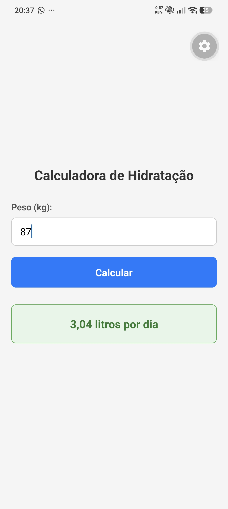

# Questão 01 - Calculadora de Hidratação

Aplicativo desenvolvido em React Native (Expo) que recebe o peso de uma pessoa e calcula uma estimativa didática de consumo diário de água.

## 📱 Demonstração

## 🚀 Como executar localmente

1. Abra o terminal nesta pasta (`questao01`).
2. Instale as dependências: `npm install`
3. Inicie o servidor: `npx expo start`
4. Escaneie o QR Code com o aplicativo Expo Go.