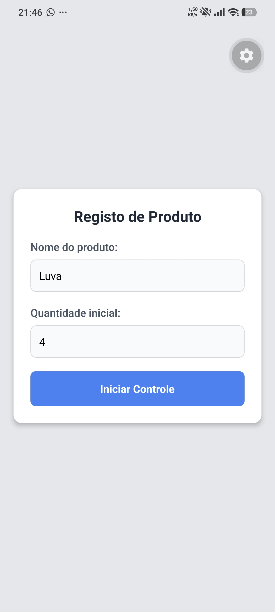
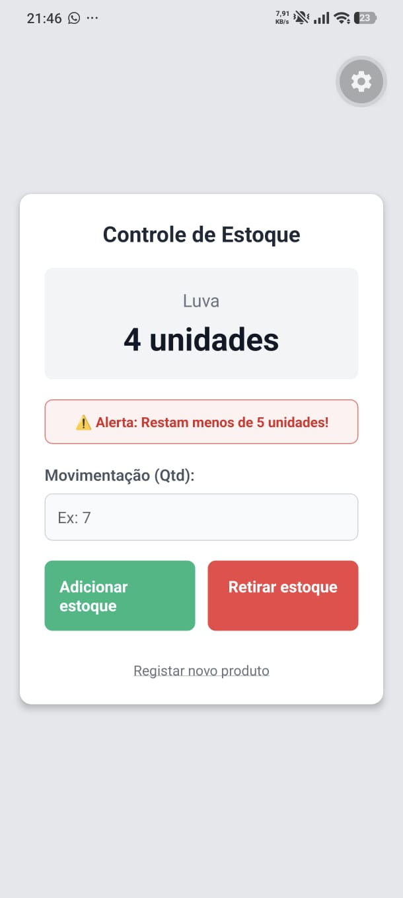

# Questão 03 - Controlo de Estoque

Aplicativo desenvolvido em React Native (Expo) que permite a pequenos estabelecimentos comerciais acompanhar as entradas e saídas de um produto. O sistema regista a quantidade inicial, permite adicionar ou retirar unidades (impedindo retiradas superiores ao valor disponível) e exibe um alerta visual quando restam menos de cinco unidades no inventário.

## 📱 Demonstração

## 🚀 Como executar localmente

1. Abra o terminal nesta pasta (`questao03`).
2. Instale as dependências: `npm install`
3. Inicie o servidor: `npx expo start`
4. Escaneie o QR Code com a aplicação Expo Go.