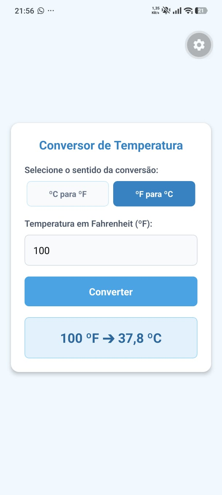

# Questão 04 - Conversor de Temperatura

Aplicativo desenvolvido em React Native (Expo) que realiza a conversão de informações meteorológicas entre as escalas Celsius e Fahrenheit. O utilizador pode selecionar o sentido da conversão (ºC para ºF ou ºF para ºC) e introduzir o valor numérico para obter o resultado.

## 📱 Demonstração

## 🚀 Como executar localmente

1. Abra o terminal nesta pasta (`questao04`).
2. Instale as dependências: `npm install`
3. Inicie o servidor: `npx expo start`
4. Escaneie o QR Code com a aplicação Expo Go.