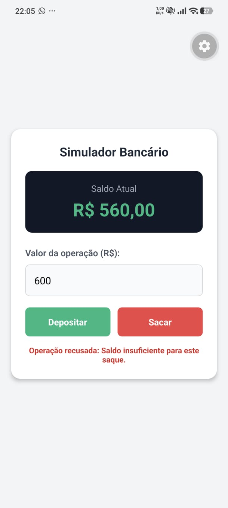

# Questão 05 - Simulador Bancário

Aplicativo desenvolvido em React Native (Expo) que simula o controlo de uma conta bancária. Inicia com um saldo de R$ 1.000,00 e permite realizar operações de depósito e saque, bloqueando valores não positivos e tentativas de saque superiores ao saldo disponível.

## 📱 Demonstração

## 🚀 Como executar localmente

1. Abra o terminal nesta pasta (`questao05`).
2. Instale as dependências: `npm install`
3. Inicie o servidor: `npx expo start`
4. Escaneie o QR Code com a aplicação Expo Go.