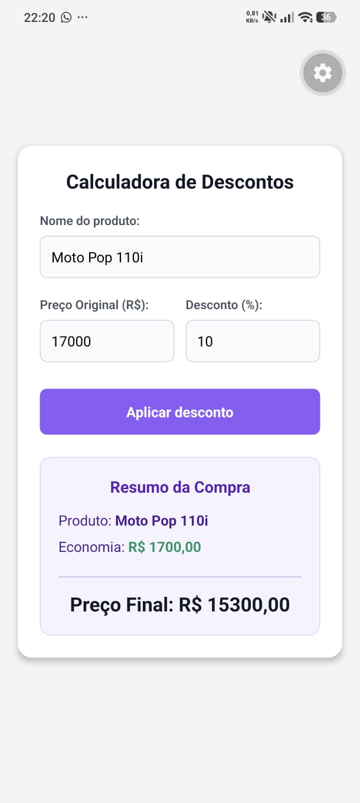

# Questão 07 - Calculadora de Descontos (E-commerce)

Aplicação desenvolvida em React Native (Expo) que simula uma funcionalidade de comércio eletrónico para calcular o preço final de um produto. O utilizador introduz o nome do produto, o preço original e a percentagem de desconto. O sistema valida os dados (impedindo preços negativos e descontos fora do intervalo 0-100%) e apresenta o valor economizado juntamente com o preço final a pagar.

## 📱 Demonstração

## 🚀 Como executar localmente

1. Abra o terminal nesta pasta (`questao07`).
2. Instale as dependências: `npm install`
3. Inicie o servidor: `npx expo start`
4. Escaneie o QR Code com a aplicação Expo Go.