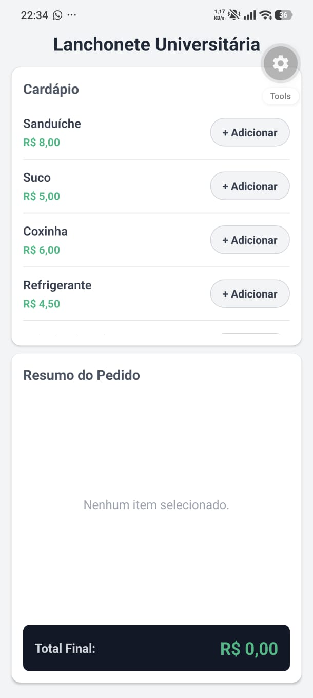
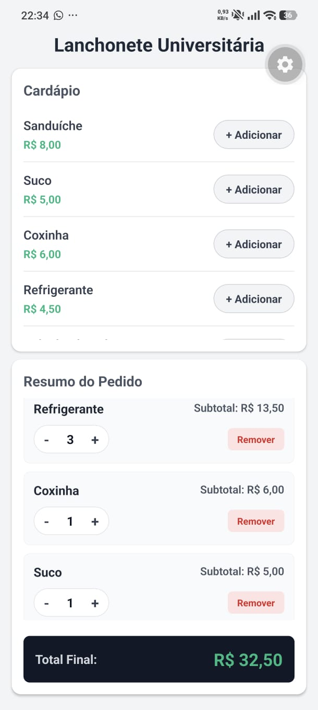

# Questão 09 - Sistema de Pedidos (Lanchonete)

Aplicação desenvolvida em React Native (Expo) para gerir pedidos de uma lanchonete universitária. O sistema disponibiliza um cardápio com produtos e preços, permitindo adicioná-los a um carrinho (array de objetos). No resumo do pedido, é possível alterar as quantidades, visualizar os subtotais por item, remover produtos e consultar o valor total a pagar em tempo real.

## 📱 Demonstração

## 🚀 Como executar localmente

1. Abra o terminal nesta pasta (`questao09`).
2. Instale as dependências: `npm install`
3. Inicie o servidor: `npx expo start`
4. Escaneie o QR Code com a aplicação Expo Go.